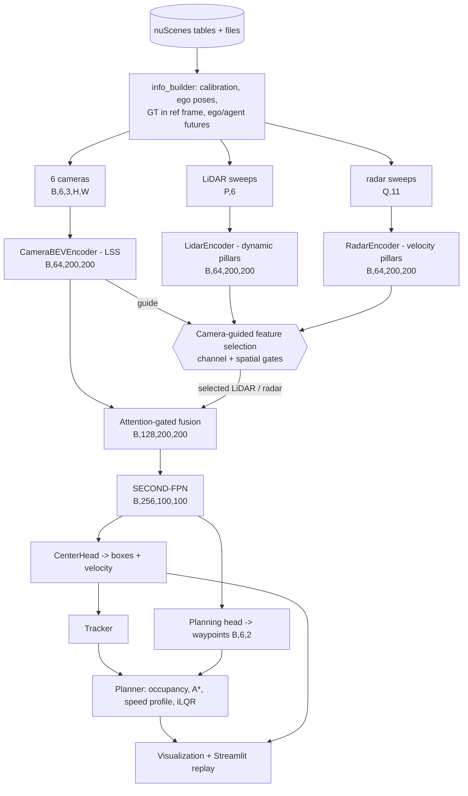

# Architecture, tensor flow and design decisions

All shapes below are for **batch size B**, the default BEV grid (`x, y ∈ [-50, 50) m`,
0.5 m cells → **200 × 200**), N = 6 cameras and the **GTX 1650 profile** (images 128 × 352,
5 LiDAR sweeps, 5 radar sweeps). With the RTX profiles (256 × 704 images) the image-plane
sizes double (`h × w = 16 × 44`). Timings are measured on the GTX 1650 (fp32, batch 1,
`scripts/smoke_test.py`), not estimated.

## A. System architecture

```
                                   nuScenes (v1.0-mini / v1.0-trainval)
                                                   │  datasets/nuscenes_db.py  (tables + reverse index)
                                                   │  datasets/info_builder.py (calibration, poses, sweeps, GT in ref frame,
                                                   │                            ego state, ego future, agent futures)
              ┌────────────────────────────────────┼──────────────────────────────────────┐
              │                                    │                                      │
     6 × camera (key-frame)              LIDAR_TOP (key-frame + sweeps)       5 × radar (key-frame + sweeps)
     camera_loader.py                    lidar_loader.py                      radar_loader.py
     resize/crop/flip/rot + K,           sensor→ego(t)→global→ego(t_ref)       PCD parse, devkit filters,
     cam2ref, post_rot/post_tran         + time-lag, range filter             positions AND velocities → ref
              │                                    │                                      │
              ▼                                    ▼                                      ▼
   ┌─────────────────────────┐        ┌─────────────────────────┐            ┌─────────────────────────┐
   │ CameraBEVEncoder (LSS)  │        │ LidarEncoder            │            │ RadarEncoder            │
   │ ResNet18+FPN → DepthNet │        │ dynamic PointPillars    │            │ dynamic pillars         │
   │ (camera-aware) → lift → │        │ + raster (density,      │            │ + raster (density, vx,  │
   │ splat → BEV refine      │        │   height, intensity)    │            │   vy, RCS, time lag)    │
   │ F_cam  (B,64,200,200)   │        │ F_lidar (B,64,200,200)  │            │ F_radar (B,64,200,200)  │
   └───────────┬─────────────┘        └───────────┬─────────────┘            └───────────┬─────────────┘
               │  spatial reference / guide        │                                      │
               │                     ┌─────────────▼──────────────────────────────────────▼─────┐
               └────────────────────►│ CrossModalFeatureSelection (camera-guided)               │
                                     │  channel gates c_m (cross-modal SE)                      │
                                     │  spatial gates s_m (CBAM-style, camera guide)            │
                                     │  F̃_m = F_m ⊙ c_m ⊙ s_m        m ∈ {lidar, radar}         │
                                     └─────────────┬────────────────────────────────────────────┘
               F_cam ───────────────────────────►  │  F̃_lidar, F̃_radar
                                     ┌─────────────▼────────────────────────────────────────────┐
                                     │ Fusion (registry: concat | attention_gated)               │
                                     │  per-cell modality attention a = softmax_m(·)             │
                                     │  Σ a_m P_m  ⊕  P_1..P_M → 1×1 → ResBlock → CBAM            │
                                     │  fused BEV (B,128,200,200)                                │
                                     └─────────────┬────────────────────────────────────────────┘
                                                   ▼
                                     SECOND-FPN BEV backbone (B,256,100,100)
                                   ┌───────────────┴────────────────┐
                                   ▼                                ▼
                       CenterHead (CenterPoint)          PlanningHead (learned)
                       heatmap(10) reg dim rot vel       ego query × BEV tokens → GRU
                                   │                                │ waypoints (B,6,2)
                                   ▼                                │
                       decode + circle NMS → boxes                  │
                                   ▼                                │
                       MultiObjectTracker (global frame)            │
                                   ▼                                ▼
                       BaselinePlanner: occupancy → A* → speed profile → iLQR MPC
                       (or learned / hybrid = learned + classical safety fallback)
                                   ▼
                       visualization/  +  app/streamlit_app.py (scene replay, faculty demo)
```

### Data-flow diagram (Mermaid; renders on GitHub / VS Code)



## B. Tensor / data flow

| Stage | Tensor | Shape (GTX 1650 profile) |
|---|---|---|
| Camera input | `images` | (B, 6, 3, 128, 352) |
| | `intrinsics`, `post_rots`, `cam2ref`, `bda` | (B,6,3,3), (B,6,3,3), (B,6,4,4), (B,4,4) |
| Image backbone | ResNet18 layer3 ⊕ up(layer4) → neck | (B·6, 256, 8, 22) |
| DepthNet | depth logits / context | (B·6, 59, 8, 22) / (B·6, 64, 8, 22) |
| Lift | depth ⊗ context | (B, 6, 59, 8, 22, 64) |
| Geometry | frustum → ref frame | (B, 6, 59, 8, 22, 3) |
| Splat | sum-pool into cells (z collapsed) | (B, 64, 200, 200) |
| LiDAR input | `lidar_points` [b,x,y,z,intensity,time_lag] | (P≈110k·B, 6) |
| Pillar VFE | per-point MLP + scatter-max | (#pillars, 64) → canvas (B, 64, 200, 200) |
| LiDAR encoder | concat raster(4) → conv → +raster | (B, 64, 200, 200) |
| Radar input | `radar_points` [b,x,y,z,rcs,vx_c,vy_c,vx,vy,dyn_prop,dt] | (Q≈450·B, 11) |
| Radar encoder | VFE + raster(5) → dilated ResBlocks → +raster | (B, 64, 200, 200) |
| Feature selection | channel gates / spatial gates | (B, 64) per sensor / (B, 1, 200, 200) per sensor |
| Fusion | attention weights / fused BEV | (B, M, 200, 200) / (B, 128, 200, 200) |
| BEV backbone | SECOND-FPN | (B, 256, 100, 100) |
| Detection head | heatmap / reg / height / dim / rot / vel | (B,10,100,100) (B,2,·) (B,1,·) (B,3,·) (B,2,·) (B,2,·) |
| Decoded boxes | `[x,y,z,l,w,h,yaw,vx,vy]` + score + label | (K ≤ 300, 9) |
| Planning head | 3× stride-2 → tokens; ego query; GRU | (B, 169, 128) → (B, 6, 2) |
| Baseline planner | dynamic occupancy / cost map | (6, 120, 140) / (120, 140) at 0.5 m |

## C. Model choices (what is implemented and why)

| Component | Implemented | Why this choice for a 4 GB GPU |
|---|---|---|
| Camera BEV | **Lift-Splat-Shoot** + BEVDepth camera-aware DepthNet + LiDAR depth supervision | Explicit depth distribution = interpretable geometry; one forward pass, no temporal queues (BEVFormer's deformable attention + history does not fit 4 GB). Depth supervision makes LSS train on 323 mini samples. Pure-PyTorch `index_add_` pooling → no custom CUDA ops on Windows. |
| LiDAR encoder | **Dynamic PointPillars** (scatter-max, no points-per-pillar cap) | Pillars give BEV directly (no 3D sparse conv / spconv build on Windows); dynamic voxelisation keeps all multi-sweep returns. |
| Radar encoder | **Dynamic pillars + dilated ResBlocks + explicit velocity raster** | Radar is ~250× sparser than LiDAR; dilations spread evidence. Velocity rotated into the ego frame and kept verbatim as output channels. |
| Feature selection | **Camera-guided cross-modal channel + spatial gating** (SE/CBAM family, optional hard-concrete binary masks) | Linear in #cells (full cross-attention over 40k BEV tokens is O(1.6·10⁹)); gates are explicit [0,1] importances → interpretable; camera BEV conditions the gates. |
| Fusion | **Attention-gated fusion** (per-cell softmax over sensors + residual mixing + CBAM); `concat` baseline via registry | Learns sensor reliability *where*; registry makes adding fusions a one-class change. |
| Detection | **CenterPoint** heatmap head with velocity | Anchor-free, simple targets, strong nuScenes baseline, velocity regression feeds tracking/planning. |
| Tracking | Greedy centre-distance association (CenterPoint) in the global frame | No learning needed; provides IDs, smoothed velocity, motion trails. |
| Planning (baseline) | Path/velocity decomposition: occupancy → **A\*** → constant-accel speed profile vs CV-forecast occupancy → **iLQR MPC** (kinematic bicycle) | Works with zero training, interpretable, dynamically feasible output. |
| Planning (learned) | Ego-query cross-attention over BEV tokens + GRU residual decoder on a constant-velocity prior | Trainable on mini; replaces the baseline through `planning.planner`. |

## D. Per-module details

### Camera → BEV (`models/camera_bev/lss.py`)
* **Input**: images (B,6,3,H,W), K, post_rot/post_tran, cam2ref, bda.
* **Output**: camera BEV (B,64,200,200), depth logits (B·6, D, H/16, W/16).
* **Architecture**: ResNet18 (ImageNet, stem+layer1 frozen, BN eval) → stride-16 neck (256) →
  DepthNet (camera-aware SE gates from a 16-d [K_aug, extrinsics] descriptor) → softmax depth
  over 59 bins (1–60 m, bin centres) ⊗ 64-d context → frustum geometry → `index_add_` splat →
  2 BEV ResBlocks.
* **Calibration use**: pixel (u,v) at depth d → `post_rot⁻¹((u,v,d) − post_tran)` (undo image
  augmentation) → `K⁻¹·(u'd, v'd, d)` (camera frame) → `cam2ref = inv(ref_ego2global) ·
  ego2global(t_cam) · cam2ego` (extrinsics **and** ego motion between camera and LiDAR time) →
  `bda` (BEV augmentation). Verified: projection/lift round trip 6·10⁻¹⁴ m.
* **Loss**: BEVDepth BCE between the depth distribution and one-hot LiDAR depth (nearest point per
  feature cell); plus the detection loss through fusion.
* **Compute**: 26 ms; 16.4 M params (12.0 M image backbone + neck, rest DepthNet / BEV refine); largest activation (6·59·8·22·64 fp32 ≈ 16 MB).

### LiDAR encoder (`models/lidar_encoder/pillar_encoder.py`)
* **Input**: (P, 6) points; **output** (B, 64, 200, 200) = 60 learned + 4 raster channels.
* **Architecture**: point decoration (raw 5 + cluster offset 3 + pillar-centre offset 2) →
  Linear-BN-ReLU (32) → scatter-max → concat → Linear-BN-ReLU (64) → scatter-max → canvas →
  ConvBNReLU + 2 ResBlocks.
* **Compute**: 18.5 ms; 0.17 M params.

### Radar encoder (`models/radar_encoder/radar_encoder.py`)
* **Input**: (Q, 11) points; **output** (B, 64, 200, 200) = 59 learned + 5 raster channels
  (density, vx, vy, RCS, time lag).
* **Velocity handling**: `vx_comp, vy_comp` are rotated with the full sensor→ref rotation
  (the devkit's multisweep loader leaves them in the sensor frame).
* **Compute**: 16 ms; 0.23 M params.

### Feature selection (`models/feature_selection/selection.py`)
* **Input**: F_lidar, F_radar (B,64,200,200), guide F_cam (B,64,200,200).
* **Output**: selected features (same shapes), channel gates (B,64) and spatial gates (B,1,200,200)
  per sensor, selection statistics.
* **Channel branch**: [mean, max] pooled statistics of all sensors (+camera) → MLP → per-sensor
  channel logits. **Spatial branch**: per sensor 1×1 compress(8) + channel mean/max → 7×7 conv →
  3×3 conv → one logit map per sensor. Gate = sigmoid (soft) or hard-concrete straight-through.
* **Loss**: `coverage` (objects must remain selected by ≥1 sensor) + `sparsity`
  (|mean gate − target ratio|) + `binarization` (4g(1−g)).
* **Compute**: 4.7 ms; 0.11 M params.

### Fusion (`models/fusion/fusion_methods.py`)
* **Input**: dict of (selected) BEV maps; **output** (B,128,200,200) + attention weights (B,M,200,200).
* **Loss** (`L_fusion`): deep supervision — a 1×1 class-agnostic heatmap head on each (selected)
  sensor map and on the fused map (Gaussian focal loss) keeps every branch discriminative.
* **Compute**: 18.6 ms; 0.51 M params. (BEV backbone: 4.0 M params, 11 ms; detection head 0.37 M, 3.4 ms; planning head 0.78 M, 3.8 ms; total model 22.6 M.)

### Detection (`models/detection/`)
* CenterHead on (B,256,100,100): heatmap (10), offset (2), z (1), log-size (3), sin/cos (2), velocity (2).
* **Loss**: Gaussian focal (classification) + L1 centre / size / orientation / velocity
  (CenterPoint code weights, velocity weight 0.2); targets in `targets.py`.
* **Decode**: 3×3 max-pool peaks → top-300 → class-wise circle NMS.

### Planning (`planning/`, `models/trajectory/`)
* **Baseline**: dynamic occupancy (T,ny,nx) from detections propagated with their velocities;
  static C-space (slow objects inflated by ego half-width); soft costs (clearance, non-ground LiDAR,
  optional map prior) → A* to a command-dependent goal → best constant acceleration against the
  dynamic occupancy → iLQR (12 iterations, 10 Hz, 30 steps). ~30 ms.
* **Learned**: (B,256,100,100) → 13×13 tokens; query = MLP(speed, yaw rate, accel, one-hot command)
  → 4-head attention → GRU (6 steps) → residual deltas on a constant-velocity prior.
* **Loss**: L1 to logged trajectory + collision (GT future occupancy under 5 ego-footprint points,
  differentiable via `grid_sample`) + smoothness (second differences) + goal (final-point error).
* **Navigation command**: LEFT/RIGHT/STRAIGHT from the logged future's lateral offset (±2 m) — the
  standard ST-P3/UniAD protocol; it stands in for a route planner.

### Total loss
```
L_total = λ1·L_detection + λ2·L_trajectory + λ3·L_feature_selection + λ4·L_fusion + λ5·L_depth
```
All λ and sub-weights live in `configs/training.yaml → loss`.

## E. Coordinate frames (single source of truth)

* Reference frame = ego frame at the LIDAR_TOP key-frame: x forward, y left, z up, origin at the rear axle.
* Quaternions `[w, x, y, z]`; nuScenes sizes `[w, l, h]` are converted once to `[l, w, h]`.
* BEV tensors are `(…, ny, nx)` (rows = y, cols = x). `visualization.common.bev_to_display` rotates
  to "forward up, left left" for display.
* Validation (`scripts/validate_sensors.py`, real mini data): LiDAR points inside GT boxes vs
  `num_lidar_pts` — Pearson r = 0.9997, 86 % exact, 97 % within 10 % over 3 322 boxes.

## F. Memory / speed engineering

* fp16 AMP is **auto-tested at start-up** (`utils/device.py::fp16_is_reliable`). On the GTX 1650 +
  cuDNN 9.10, fp16 3×3 convolutions with 256 input channels return NaN, so AMP is disabled
  there; it stays on for GPUs that pass (RTX 30/40, Orin).
* Gradient checkpointing (image backbone layers 2-4, BEV backbone blocks), gradient accumulation,
  configurable batch size, persistent DataLoader workers, cuDNN autotune.
* Measured on the GTX 1650 (proposed model F, batch 1): **training peak 3.2 GB**, **inference 0.77 GB,
  ~100 ms (≈10 FPS)**; LiDAR+radar-only models: 0.4 GB, ~70 ms.
